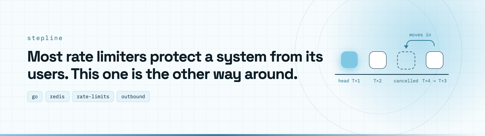
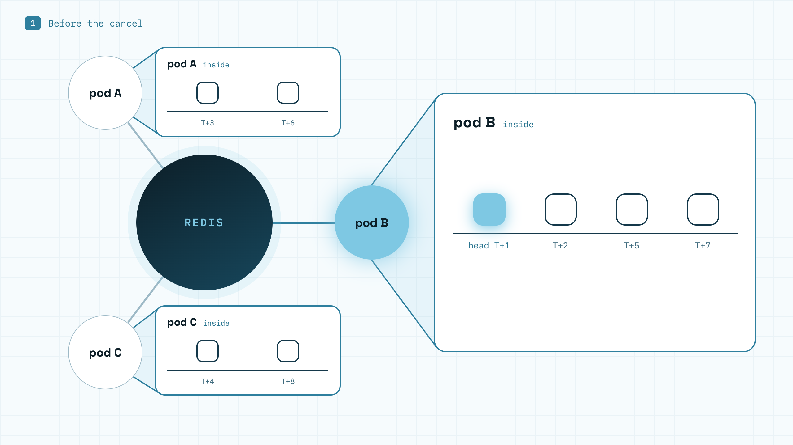
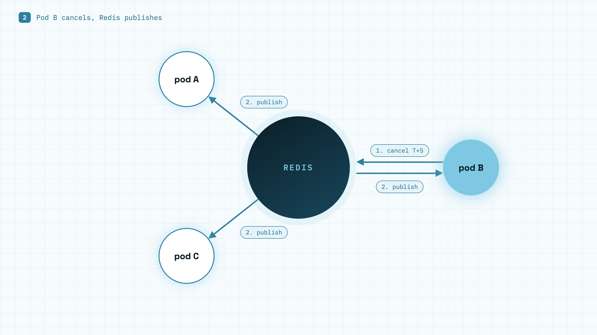
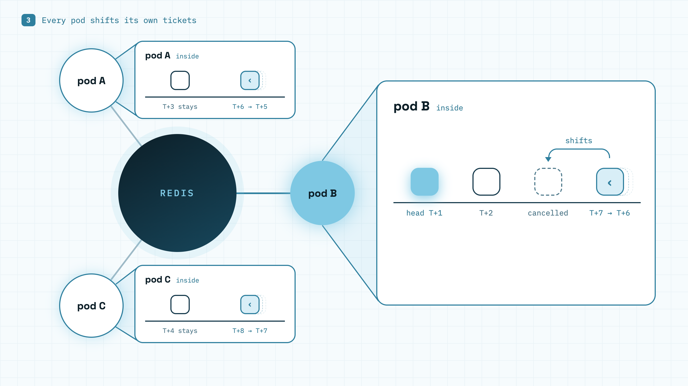

<picture>
  <source media="(prefers-color-scheme: dark)" srcset=".github/assets/banner-dark.webp">
  
</picture>

Simple, distributed, reverse rate limiter in Go.

Stepline is a Go library that puts calls to an external API into a queue
and lets them out one per interval. It is backed by Redis and built for
one job: your own traffic must never hit the provider's rate limit.

Reverse, because it limits you, not your users. A normal rate limiter
counts incoming requests and rejects the extras. Stepline puts your
outgoing calls in one queue and spaces them out evenly, one per interval,
so the provider never answers 429.

The queue is one for everyone. It lives in Redis, so every pod of every
service that shares the same provider budget waits in the same queue, in
arrival order, and the pace holds across the whole fleet.

## How it works

**1. Before the cancel.** Each pod calls `Wait(ctx)` to enqueue its
tickets. Redis enqueues them sequentially, in arrival order.

<picture>
  <source media="(prefers-color-scheme: dark)" srcset=".github/assets/cancel-1-dark.webp">
  
</picture>

**2. A goroutine in pod B is cancelled.**

<picture>
  <source media="(prefers-color-scheme: dark)" srcset=".github/assets/cancel-2-dark.webp">
  
</picture>

**3. Each pod shifts.**

<picture>
  <source media="(prefers-color-scheme: dark)" srcset=".github/assets/cancel-3-dark.webp">
  
</picture>

## Contents

- [Adding it to your system](#adding-it-to-your-system)
- [Errors](#errors)
- [Limits](#limits)
- [Logging](#logging)
- [Glossary](#glossary)
- [More](#more)

## Adding it to your system

1. One limiter per provider budget, usually one API key. The key names the
   budget, for example `slack`.
2. Create the store with `redisstore.NewStore(ctx, client, key, rate,
   period)`, then the limiter with `stepline.NewLimiter(ctx, store)`. Both
   return an error if Redis is not reachable.
3. Timeouts and retries for Redis calls belong to your Redis client. With
   go-redis, keep the defaults of `DialTimeout`, `ReadTimeout`,
   `WriteTimeout` and `MaxRetries`.
4. Call `Wait(ctx)` before every request that spends the budget, all of
   them, not only the busy ones. How you wire it into your code is up to
   you.
5. On shutdown call `Shutdown(ctx)`. Waiting calls finish while `ctx` lives,
   the rest get `ErrClosed`.

## Errors

`Wait(ctx)` returns one of:

| Result | Meaning |
|---|---|
| `nil` | your turn, call the provider |
| `ctx.Err()` | the context ended while waiting, the call left the queue |
| `ErrDeadlineTooShort` | the queue is longer than your deadline, refused at once |
| `ErrNoDeadline` | the context has no deadline |
| `ErrStoreUnavailable` | Redis failed, nothing was paced, you decide whether to call anyway |
| `ErrClosed` | the limiter is shutting down |

A deadline is required: it is the only limit on how long a call waits. Use
a long one if you mean "as long as it takes".

A 429 from the provider is yours to handle: call `Wait` again and retry, or
give up. See [docs/429.md](docs/429.md).

## Limits

- One call per interval, evenly spaced. The rate is set once, N per second
  or per minute. No bursts.
- The smallest interval is 5ms, 200 calls per second.
- A call can start a few milliseconds late, never early. Lateness does not
  add up. No sub-millisecond precision.
- Every call to the provider for a budget must go through its Limiter. A
  call that skips it, or a cheaper provider plan with the old rate, brings
  429s back.

## Logging

Pass a `*slog.Logger` with `stepline.WithLogger` and `redisstore.WithLogger`.
Without it nothing is logged. Debug is the normal flow, Warn is a problem
no caller can see, like a failed background read from Redis.

## Glossary

- Limiter key: the name of one provider budget. Every process that spends
  the budget uses the same key and shares one queue.
- Queue: the tickets of one limiter key, waiting in arrival order in Redis
  and shared by every process. The first fires at head, each next one an
  interval later.
- Ticket: one `Wait` call in the queue. The store gives it a number that
  counts up and is never reused. In the Limiter it is the `ticket` struct.
- Registry: the tickets of one Limiter, ordered by number.
- Interval: `period / rate`. 1s at 60 per minute.
- Head: the slot of the first ticket still waiting. With an empty queue,
  the earliest slot the next ticket may take. A timestamp on the Redis
  clock in its own key (see [State](docs/design.md#state-per-limiter-key)).
  When a ticket fires, head moves by exactly one interval, so a late call
  does not delay the next one.
- Slot of a ticket: `head + n * interval`, where n is the number of
  tickets ahead of it. Never stored, always derived.
- Fire: a ticket reaches its slot and `Wait` returns nil.
- Trim: the Store removes tickets whose slot has passed.
- Cancel: a ticket leaves the queue before its slot.
- Wait: the duration from now to a ticket's slot, sent in the enqueue
  reply.
- dueAt: the same moment on the Limiter's local monotonic clock.
- Reply: the answer to a request, seen by one ticket.
- Event: one entry in the Redis stream of a limiter key, read by every
  process. The only kind is a cancel, `CancelEvent`.
- Version: a counter incremented on every change that produces an event.

## More

- [docs/design.md](docs/design.md): how it works.
- [docs/store.md](docs/store.md): writing your own store.
- [Issues](https://github.com/go-dev-stack/stepline/issues): what comes next.
- [docs/429.md](docs/429.md): why the limiter does not handle 429.
